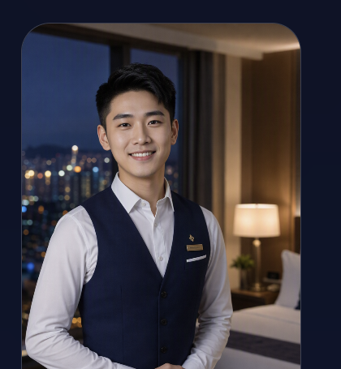
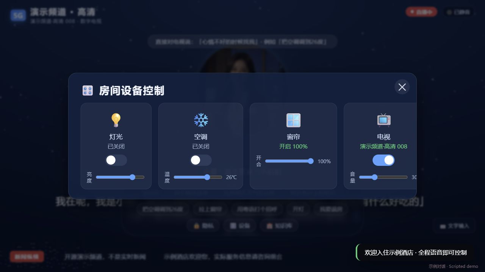

<div align="center">

# 酒店 TV 智能体 · Hotel TV Agent

**从看电视，到一句话找到陪伴与帮助。**  
**From watching TV to finding company and help with a conversation.**

面向客房大屏的 AI 管家原型：角色陪伴、服务问答、设备控制演示与退房数据清理。  
A hotel-room screen assistant prototype: character companionship, service Q&A, simulated device controls, and checkout data cleanup.

[完整源码 / Download source](./hotel-tv-agent-sanitized-source.zip) · [快速开始 / Quick start](#快速开始--quick-start) · [参与贡献 / Contribute](https://github.com/fanalar/hotel-tv-agent/issues)

**MIT code · React + FastAPI · Android source · Local demo**


</div>

## 让客房大屏可以聊，也可以帮忙 / A room screen that can talk and help

“我想让小姐姐陪我”“把空调调到 26 度”“讲个晚安故事”——把陪伴、房间操作和服务信息放进同一个入口，方便探索客房 AI 交互。  
“I’d like a companion,” “Set the air conditioner to 26°C,” or “Tell me a bedtime story”—explore a single conversational entry point for companionship, room controls, and service information.

**当前为本地演示：客房、设备状态、频道与知识库为示例，没有接入实际酒店、PMS、真实房控或实时电视直播。**  
**This is a local prototype: rooms, device states, channels, and knowledge entries are demonstrations. No actual hotel, PMS, room controller, or live-TV integration is included.**

## 两位管家，两种相处方式 / Two companions, two styles

<table>
<tr>
<td align="center"><br><b>小暖 · Xiaonuan</b><br>温柔陪伴，聊聊今天，也听听你的心情。<br>Warm company for a conversation about your day.</td>
<td align="center"><br><b>阿哲 · Azhe</b><br>从日常聊天，到行程与房间操作。<br>A conversational companion for plans and room interactions.</td>
</tr>
</table>

*展示图来自原项目，功能截图使用隔离演示数据。开源源码默认使用占位素材；图库不属于代码 MIT 的素材授权。*  
*Preview artwork comes from the original project; screenshots use isolated demo data. The source archive uses placeholders. The gallery is not relicensed under the code’s MIT license.*

## 功能一览 / What you can explore

| 能力 / Capability | 场景 / Scenario |
|---|---|
| 角色与对话 / Characters & chat | 选择管家，日常聊天或晚安故事。 / Choose a companion for conversation or bedtime stories. |
| 语音与文字 / Voice & text | 大屏语音交互原型与文字输入备用入口，支持情况取决于平台。 / A voice-first screen prototype with text input; support depends on the platform. |
| 房间设备 / Room controls | 灯光、空调、窗帘和电视状态演示。 / Simulated light, air-conditioner, curtain, and TV states. |
| 服务知识库 / Service knowledge | 本地示例知识库，可替换为获准使用的酒店资料。 / Local sample knowledge entries that can be replaced with authorized service information. |
| 天气与检索 / Weather & lookup | 公开资讯与天气入口；来源可达性影响结果。 / Public information and weather lookup, subject to source availability. |
| 退房清理 / Checkout cleanup | 清理演示会话数据，探索客房使用周期中的隐私流程。 / Clear demo session data and explore a room-session privacy flow. |
| Android 客户端 / Android client | 原生安卓客户端源码，运行时配置服务连接。 / Native Android source with runtime service configuration. |



*这张图展示软件中的演示状态，不表示已连接真实房间设备。*  
*This screenshot shows simulated software states, not actual connected room hardware.*

## 快速开始 / Quick start

**先下载并解压完整源码包。网页 Git 目录尚在整理，源码包包含完整代码与构建说明。**  
**Download and extract the complete source archive first. The browsable Git tree is still being organized.**

需要 / Requirements: **Python 3.11 · Node.js 20+**。

```powershell
Invoke-WebRequest "https://github.com/fanalar/hotel-tv-agent/raw/refs/heads/main/hotel-tv-agent-sanitized-source.zip" -OutFile source.zip
Expand-Archive ./source.zip ./hotel-source
cd hotel-source
python -m venv backend/.venv
backend/.venv/Scripts/python -m pip install -r backend/requirements.txt
Copy-Item .env.example .env
cd frontend
npm ci
npm run build
cd ..
backend/.venv/Scripts/python backend/main.py
```

打开 / Open: **http://127.0.0.1:8000**。没有模型密钥时使用本地兜底回复和演示设备状态；需要模型时填写自己的 `.env`。  
Without a model key, the app uses local fallback replies and simulated device states. Configure your own `.env` for model access.

**Android 源码 / Android source:** JDK 17、Android SDK 35，在解压目录运行 `python scripts/fetch_android_model.py` 和 `python scripts/android_gradle.py assembleDebug`。模型、依赖与签名不随源码包分发。  
Use JDK 17 and Android SDK 35 with the included model-download and Gradle scripts. Models, library binaries, and signing materials are not bundled.

## 适合谁探索 / Who this is for

- 开发者：研究 TV 交互、对话 UI 与本地服务原型。 / Developers exploring TV interaction, conversational UI, and local service prototypes.
- 酒店数字化团队：评估客房大屏里的陪伴和服务入口，另行开发实际集成。 / Hospitality teams evaluating conversational room-screen concepts before implementing real integrations.
- 开源贡献者：完善语音兼容、房控适配器、知识检索、多语言与无障碍体验。 / Contributors improving speech compatibility, room-control adapters, retrieval, languages, and accessibility.

## 状态、安全与许可 / Status, safety & licensing

- 演示原型，不是生产酒店系统；默认仅监听本机，无生产用户鉴权或客房隔离。 / A demo prototype, not a production hotel system; loopback by default, without production authentication or room isolation.
- 前端构建、隔离 API、安卓 Java 源码编译及密钥扫描通过；真实酒店、实际模型与真机验收未完成。 / Frontend build, isolated APIs, Android Java compilation, and secret scans passed. Real-hotel, live-model, and handset acceptance remain unverified.
- 没有实际客户资料、数据库、模型密钥或原 Git 历史。 / No real customer data, databases, model keys, or original Git history are included.
- 代码 [MIT](./LICENSE)，依赖见 [NOTICE](./NOTICE.md)，展示素材见 [MEDIA_NOTICE](docs/showcase/MEDIA_NOTICE.md)。 / MIT code; dependency and image terms are documented separately.
- 完整源码包 SHA-256：`d073a0303bb3d9e3be7b28ad4efa209256577458e61f25248bdf8640cf656a9b`。

**欢迎 Star、反馈客房交互想法，或一起完善一个具体场景。**  
**Leave a star, share a room-screen interaction idea, or help improve one concrete scenario.**
